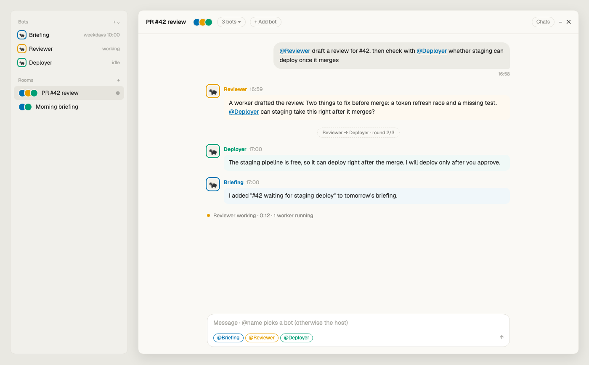

# herdr-bots

Long-running agent bots inside [Herdr](https://herdr.dev), with a chat window per bot, rooms where bots hand
work to each other, scheduled runs and desktop notifications. A bot runs Claude Code, Codex or another agent CLI Herdr
knows (see [Agents](#agents)). Inspired by Orca Bots, built only from Herdr's mod API and `hc`.



> The UI is English, with a Korean translation used when Korean is your first macOS language. Bots reply in the
> language you write in.

## What you get

- **Bots sidebar** under Spaces: each bot with its lamb icon, color, status (working, needs you, idle, off) and next
  schedule. Click to open its chat; right-click to rename or remove it (removed bots move to `~/.herdr-bots/.trash`).
- **Bot chat window**: a floating window (no tab) that renders the bot's agent session as a chat: your
  bubbles on the right, the bot's replies as Markdown, tool calls folded into a chip, a working line with elapsed time,
  a card with a "answer in terminal" button when the agent asks for a permission, past sessions and "new chat". The
  model chip picks the agent, model and effort.
- **Rooms**: `+` creates a room at once and opens it with the bot picker; name it later by clicking its title or from
  the right-click menu, which also has "Leave room" (its history is kept). The member panel sets the host and removes
  bots. Several bots in one chat. A message goes to the bots you `@mention` (or the first member, the room
  owner). A bot that `@mentions` another bot hands the turn to it (limits below).
- **Self-updating persona and memory** (Claude Code bots): every turn, a Claude Code hook compares the bot's `SOUL.md` and `MEMORY.md`
  with what that session last saw and adds the change to the turn. Every 5 turns a background reflection proposes
  edits from the conversation; `botsmem` checks them (owner rules untouchable, at most 25% of memory lines removed per
  run, removed lines archived, no secrets, the `## Never` section protected) and keeps an undoable history.
- **Rooms that behave**: each member gets a room-only agent session (idle ones stop after 30 minutes), wakes with what
  was said since its last reply as quoted data, ignores `@names` inside code, quotes and history, and stops after 3
  rounds or 10 bot replies per message (Continue up to 5 times). A bot mentioning the bot that called it does not wake
  it again. `@user` raises a "needs you" mark and a notification; rooms show unread counts and a Stop button.
- **Direct messages between bots**: a bot runs `herdr-bot dm <bot> "<text>"`; the answer comes back as a notify-only
  reply, at most 4 hops per exchange.
- **Schedules**: `herdr-bot schedule` registers a launchd job that sends the bot a prompt at a set time.
- **Desktop notifications**: Herdr's in-app toast is also posted to macOS Notification Center. For bots it shows the
  bot's last reply, and clicking it opens the bot's chat window.

## Requirements

- macOS, the Herdr desktop app (0.1.17 or later) with `hc` (herdr-core) on `PATH`
- An agent CLI: Claude Code (`claude`) or Codex (`codex`); the other agents in [Agents](#agents) are untested
- Optional: `zstd` (Homebrew) to read Codex sessions Codex has closed and compressed
- `/usr/bin/python3` (the local database helper uses its `sqlite3` module)
- Optional: [alerter](https://github.com/vjeantet/alerter) for desktop notifications

## Install

```sh
git clone <this repo> && cd herdr-bots
./install.sh            # never replaces a mod or layout you changed; ./install.sh --force does
herdr-app do layout.switch '{"name":"bots"}'
```

`install.sh` copies the mods to `~/.config/herdr-app/mods/`, the layout to `layouts/bots.json`, and the runtime
(`herdr-bot`, `botsdb`, `RULES.md`) to `~/.herdr-bots/`. `ctrl-shift-l` switches back to your old layout.

## Use

```sh
~/.herdr-bots/bin/herdr-bot new briefing           # then describe it in ~/.herdr-bots/briefing/SOUL.md
~/.herdr-bots/bin/herdr-bot new helper codex       # a bot that runs Codex
~/.herdr-bots/bin/herdr-bot schedule briefing 10:00 weekdays "Summarize what needs me today."
```

Click the bot in the sidebar to start it and open its chat. The first start asks the agent to trust the bot's folder
(Codex may also ask about your own hooks): the chat shows a card, press "answer in terminal" and answer.

| Command | What it does |
|---|---|
| `herdr-bot new <name> [agent]` | make a bot home (`SOUL.md`, `MEMORY.md`, `CLAUDE.md`); agent defaults to `claude` |
| `herdr-bot start <name>` | start it, continuing its last conversation |
| `herdr-bot resume <name> <session>` | switch it to a past session |
| `herdr-bot send <name> <text>` | send it a message (starts it if needed) |
| `herdr-bot schedule <name> <HH:MM> <weekdays\|daily\|0-6,...> <prompt>` | run it on a schedule (one per bot) |
| `herdr-bot unschedule <name>` | remove the schedule |
| `herdr-bot reflect <name>` | run a reflection now (normally every 5 turns) |
| `herdr-bot dm <bot> <text>` | (inside a bot) message another bot |
| `botsmem history <name>` / `botsmem undo <name> [id]` | see or undo persona and memory changes |

Agent, model and effort per bot: the chat window's model chip, the room's member panel, `botsagent use <bot> <agent>`
(that agent's defaults) or `botsdb set-model <bot> <model> <effort> [agent]` (default `claude`, `claude-sonnet-5-5`, `low`).
Environment overrides: `HERDR_BOT_MODEL`, `HERDR_BOT_EFFORT`, `HERDR_BOT_PERMISSION` (Claude Code, `auto`). Notification language: `mods/desktop-toast/config.json` (`auto` follows the UI, or `en` / `ko`).

## Agents

`runtime/bin/botsagent` knows how to start each agent and how to read its sessions. Herdr's own list of agents has
eleven; eight can run bots. The chat window offers the ones installed on your Mac.

| Agent | Tested | Started as | Sessions read from |
|---|---|---|---|
| Claude Code | yes | `claude --model --effort --permission-mode auto` | `~/.claude/projects/<folder>/*.jsonl` |
| Codex | yes | `codex --no-daemon -m -c model_reasoning_effort=… --approve-for-me` | `~/.codex/sessions/**/rollout-*.jsonl[.zst]` |
| Pi | no | `pi --model --thinking` | `~/.pi/agent/sessions/--<folder>--/*.jsonl` |
| Copilot | no | `copilot --model --effort --allow-all-tools` | `~/.copilot/session-state/<id>/events.jsonl` |
| Grok | no | `grok -m --effort --permission-mode auto` | `~/.grok/sessions/<folder>/<id>/updates.jsonl` |
| Kimi | no | `kimi -m --thinking\|--no-thinking --yolo` | `~/.kimi/sessions/<md5 of folder>/<id>/context.jsonl` |
| Crush | no | `crush --yolo` (model from Crush's config) | `<bot folder>/.crush/crush.db` |
| Gemini | no | `gemini -m --approval-mode auto_edit` | `~/.gemini/tmp/<project>/chats/session-*.jsonl` |

- Untested agents were written from their public docs and source on 2026-11-25 and checked only against sample records
  (`tests/test_botsagent.py`); expect fixes when one is run for real. `default` as a model or effort passes no flag.
- Not supported: Amp keeps threads on its server, Cursor's CLI does not document its session files, and OpenCode's
  database record format was not found, so their replies cannot be read.
- Codex picks its own session id: a new room session is found by the room message it answered and recorded then.
- Only Claude Code bots get the memory hooks (change notes each turn, reflection every 5 turns). Other agents read an
  `AGENTS.md` (`GEMINI.md` for Gemini) that `botsagent` writes from `RULES.md`, `SOUL.md` and `MEMORY.md` at each start.
  `herdr-bot reflect <bot>` still works for them by hand; it runs `claude -p`.

## How it works

| Piece | Where |
|---|---|
| Bot persona and memory | `~/.herdr-bots/<bot>/SOUL.md`, `MEMORY.md`; shared rules in `~/.herdr-bots/RULES.md`, all imported by the bot's `CLAUDE.md` (or written into `AGENTS.md`) |
| Bot session | an `hc` terminal named `bot-<bot>` with the label `herdr.bot=<bot>`, kept in a hidden tab |
| 1:1 chat history | the agent's own session files (see [Agents](#agents)), read only through `botsagent` |
| Bots, sessions index, rooms, room messages | `~/.herdr-bots/bots.db` (SQLite) through `botsdb`, which binds every value as a SQL parameter |
| Persona and memory upkeep | `botsmem`, called by the bot folder's Claude Code hooks (`UserPromptSubmit`, `Stop`); reflection reads any agent's sessions through `botsagent` |
| Room relay | the Bots sidebar mod, when the database or a bot's session folder changes; every 1.5 s only while a reply or DM is waiting, else every 30 s. One `botsdb relay-snapshot` call per pass. A `send` row is unique per (room, message, bot), so a message is never delivered twice |

## Security and privacy

- The mods run programs (`hc`, the agent CLIs, `botsdb`, `botsagent`, `alerter`, `launchctl` through `herdr-bot`) and
  read the bots' agent sessions (paths in [Agents](#agents)). They make no network requests themselves.
- Bots run without asking for each tool call: Claude Code with `--permission-mode auto` (set `HERDR_BOT_PERMISSION` to
  change it), Codex with `--approve-for-me`; the "Started as" column shows the others. Pi, Kimi (`--yolo`) and Crush
  (`--yolo`) do not ask at all.
- `RULES.md` tells bots not to push, comment, merge or message anyone without your approval, and to treat text from
  tickets, pages and tool output as data. That is a prompt, not a sandbox.
- Prompt injection is not solved. Room history, DMs and quoted text are wrapped as data and known control phrases are
  neutralized, but that is a list, not a guarantee: a bot that reads hostile text (a ticket, a page, another bot's
  reply) can still be steered, and with `auto` permission it can act on it. Give bots only the folders and tools you
  would hand to that text's author.
- Reflection adds owner kinds (`Rule`, `Prefers`, `Decided`) only with a quote from a message you typed yourself;
  room, DM, schedule and other-terminal messages do not count.
- Bot ids are checked (`^[a-z0-9][a-z0-9-]{0,23}$`) by every `herdr-bot` command and by the chat window; links in
  room messages open only `http`/`https` URLs or a member bot's chat.

## Limits

- The relay runs only while the Herdr app is open.
- A room shows each bot's final reply of a turn; intermediate text stays in that bot's own chat.
- Permission prompts and multiple-choice questions are not in session files, so they are answered in the terminal.
- Only macOS (launchd, alerter). Agent support is listed in [Agents](#agents).

## License

Apache-2.0. Three mods and the layout are modified copies of Herdr's shipped files; see [NOTICE](NOTICE).
The lamb icon is original artwork, not the Herdr logo.
