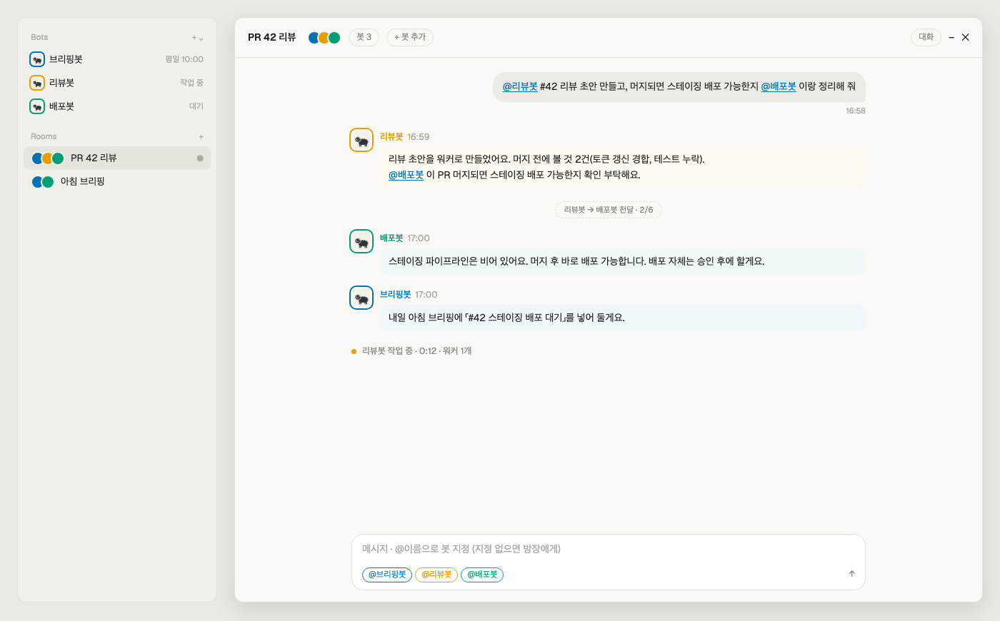

# herdr-bots

A Bots section under Spaces lists long-running Claude Code bots and rooms of bots. Clicking one opens a floating chat
window that reads like a messenger: your bubbles right, the bot's Markdown replies left, its state live.

## What you see

- Sidebar (layout `bots`, Herdr's `main` tree): Spaces, then a `bots` block of 230px, then Agents.
  - "Bots" header (11.5px, `dim`) with `+` (new bot, inline name input) and a fold chevron.
  - One 30px row per bot: 16px lamb icon in a 1px ring of the bot's color, title (`foreground`, or `muted` when off),
    a status or schedule line (11.5px), a 6px dot: `blocked` "응답 필요", `working` "작업 중", `done` "완료",
    `idle` with the schedule text, hollow ring when off. Right-click: a 240×132 popup with Open chat, Rename, Remove
    bot (asks once more, in `blocked` color).
  - "Rooms" header with `+` (creates an untitled room at once), one row per room: overlapping 14px dots of member colors,
    title ("Untitled room" in `muted` when empty), an unread count, a dot in `working` or `blocked` when a member is or
    a bot asked `@user`. Right-click: Open, Rename, Leave room (asks once more).
  - Every label is chosen from the macOS language (`defaults read -g AppleLanguages`): Korean or English.
- Bot chat window (`kind: "window"`, 520×680, key `chat-<bot>`): 52px header with the lamb and a status badge, title,
  model chip, "대화", "터미널 보기", `–` minimize (to 320×52) and `✕`. Messages in a 760px column with date dividers;
  your bubble `selected`, 18px radius; bot rows: 28px lamb, name, time, "복사", a tool chip
  "▸ 도구 N회 · names" that unfolds one line per call; a working line; a blocked card. Composer: auto-growing textarea
  (2–8 rows), send `↑`, stop `■` while working.
- Room window (620×720, key `room-<room>`): title, member dots, "봇 N", "+ 봇 추가". Bot bubbles in a 6% tint of the
  bot's color, name in that color, a 26px lamb in a 2px ring. Hand-offs show as a pill "A → B 전달 · n/6". Mentions in
  messages are links (`bot:<id>`) that open that bot's chat. Composer mention buttons are outlined in the bot's color
  and insert a colored token at the end.
- Colors: Okabe-Ito `#0072B2 #E69F00 #009E73 #CC79A7 #D55E00 #56B4E9` by bot id order.

## How it behaves

- working: the window shows "작업 중 · m:ss · <what the bot reports> · 워커 N개"; blocked: a card with the bot's
  question and "터미널에서 답하기" (`terminal.peek`); done/idle: nothing extra.
- Sending: the bubble appears at once ("보내는 중"), `hc send` runs in the background; an off bot is started first.
- New replies scroll to the start of the reply; your message scrolls to the end.
- Rooms: your message goes to `@mentioned` members, else the first member (host). Each member answers in a room-only
  session and wakes with what was said since its last reply as `<quoted_room_history>`. A reply's `@mentions` of other
  members are delivered next, up to 3 rounds and 10 bot replies per message (then a Continue card, up to 5 times). A bot
  mentioning the bot that called it does not wake it. `quiet` or `조용` stays silent; `@user` marks "needs you".
- Room window: click the title to rename; the member panel shows the host, "Make host", "Remove" and model choices;
  "■ Stop" appears while a member works.
- Memory: a `UserPromptSubmit` hook adds `SOUL.md` / `MEMORY.md` changes to the next turn; every 5 turns a background
  reflection edits them through checks, with `botsmem history` / `undo`.
- Notifications: every toast is also posted through `alerter --sender dev.herdr.app`; for a bot the title is its
  name and the body its last reply; clicking runs `bots.chat-<bot>`.

## Built from

- Layout: `main` with `agents` → `agents-bots`, `tabs` → `tabs-bots`, a `bots` block after `spaces`, root
  `"toast": "desktop-toast"`.
- Mods: `bots` (sidebar, relay, `nextCommand` for `chat-<bot>`, `room-<room>`, `relay`), `bot-chat`, `bot-room`,
  `desktop-toast` (from `toast`), `agents-bots` (from `agents`), `tabs-bots` (from `tabs`). Icons reuse
  `mods/workspace-chrome/*.svg`; the lamb is `mods/bots/lamb.png`.
- Herdr functions: `agents`, `terminals`, `openOverlay` (windows, popup), `run` (`terminal.peek`, `agent.focus`),
  `shared`/`setShared` (`bots.titles`, `bots.colors`), `exec`, `hc`, `TextView.markdown().on_link_click`,
  `TextareaState` tokens.
- Programs: `~/.herdr-bots/bin/herdr-bot` (`hc run --keep --no-parent --label herdr.bot=<bot>`, `terminal.keep`,
  `tab.settle`, launchd plists), `~/.herdr-bots/bin/botsdb` (Python `sqlite3`, `~/.herdr-bots/bots.db`), `claude`,
  `alerter`.

## Watch out

- `terminal.park` ends a `--no-parent` terminal: keep the bot in a settled tab and hide it in the tab bar instead.
  Shipped `tabs` lists settled tabs, hence `tabs-bots`.
- `scroll_to_item` only reaches direct children of the scroll element: give every message row its own wrapper.
- Rebuilding Markdown elements every poll flickers: reuse unchanged message objects.
- `hc send` waits about 3 s of quiet before typing; messages are typed into the bot, so expect that delay.
- Claude Code names transcript folders after the cwd with every non-alphanumeric character turned into `-`.
- `claude -n` overwrites the session title; don't pass it.
- `herdr-app check` writes `gpui-kit.d.ts` and `jsconfig.json` into the mod folder.
- Room sessions live in the bot's folder too, so "the newest transcript" may be a room: look up the 1:1 session with
  `botsdb chat-session` (also for `--resume`; `--continue` can pick a room session).
- Two reads of the room (after sending and on a folder change) can overlap: drop events at or below the last seen `seq`.
- A headless `claude -p` for reflection loads every skill and MCP description (676,244 tokens measured); run it in an
  empty folder with `--setting-sources project --tools "" --disable-slash-commands --strict-mcp-config --system-prompt`
  (985 tokens).

## Done when

- `herdr-app check` passes for all six mods.
- A bot made with `herdr-bot new` shows in the sidebar; clicking opens its chat window and no tab appears.
- A message typed in the chat appears at once and the reply arrives as a Markdown bubble.
- In a room with two bots, `@A ask @B ...` produces A's reply, a hand-off pill and B's reply, all under one root.
- After adding a line to `MEMORY.md`, the bot answers about it in its next turn without reading the file.
- `herdr-bot remove` moves the bot folder to `.trash` and `botsdb bots` no longer lists it.
- Inserting the same `send` row twice with `botsdb room-append` reports `inserted: [false]` the second time.
